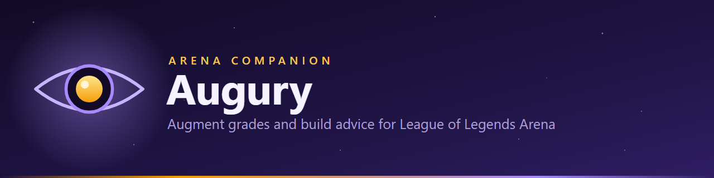

  

  <a href="https://discord.gg/feanZupp46"><b>Discord</b></a>
  &nbsp;·&nbsp;
  <a href="https://github.com/Troooge/augury/issues/new?template=bug_report.yml"><b>Report a bug</b></a>
  &nbsp;·&nbsp;
  <a href="https://github.com/Troooge/augury/issues/new?template=feature_request.yml"><b>Suggest a feature</b></a>

Augury reads your Arena game as you play. It grades every augment offer for the champion you're on, and plans your build around what you already have. Everything comes from top players' games on the current patch.

## What it does

- **Augment grades.** Every offer is graded for your champion and the build you're on, not a one-size-fits-all tier list.
- **Build planning.** Your item path updates as you buy, so the advice follows what you actually have.
- **Champ select rankings.** See which champions fit your lobby before you lock in.
- **Match history.** Look back at your runs and the picks you made, if you choose to turn it on.

## Download

Augury isn't out yet. [Join the Discord](https://discord.gg/feanZupp46) and you'll be the first to know when it is.

## Found a bug? Got an idea?

The best place is the [Discord](https://discord.gg/feanZupp46): post bugs in `#report-a-bug` and ideas in `#feature-requests`. We keep your post updated as we work on it, and ping you when the fix ships. You can also open an issue here.

For bugs, please paste the output of **Settings → Copy diagnostics** from the app. It tells us your version and setup.

## License

Augury is closed source. All rights reserved.

---

Augury isn't endorsed by Riot Games and doesn't reflect the views or opinions of Riot Games or anyone officially involved in producing or managing Riot Games properties. Riot Games, and all associated properties are trademarks or registered trademarks of Riot Games, Inc.
